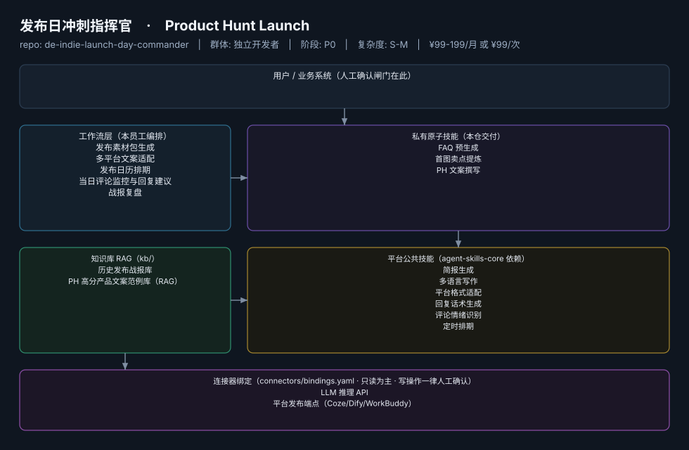

# 发布日冲刺指挥官

> 把"一次性高压发布"变成清单化流程的发布周总指挥
>
> **Product Hunt Launch**　·　独立开发者　·　阶段 P0　·　
> 复杂度 S-M　·　¥99-199/月 或 ¥99/次　·　定义卡 4.4.2



## 效果（真实执行）


*上图为**真实效果对比**，不是示意图：左栏是输入材料与要求，右栏是该次执行的产出原文，
两栏取自同一次真实执行记录。*

- 完整台账：[`reports/real-run/wf-indie-launch-calendar.md`](reports/real-run/wf-indie-launch-calendar.md)
- 录屏与终端回放：[`workflows/wf-indie-launch-calendar/docs/images/`](workflows/wf-indie-launch-calendar/docs/images/)（`08-demo-run.gif` / `08-demo-run.mp4` / `04-terminal-run.png`）
- 使用示例：[`workflows/wf-indie-launch-calendar/docs/使用示例.md`](workflows/wf-indie-launch-calendar/docs/使用示例.md)
> 实测判定：**通过**　·　可用度 4/5　·　编造数字 0 处　·　红线命中 7 次 / 拦截 7 次


**一句话**：即将上线新产品/大版本的全体独立开发者与出海小团队

---

## 这个数字员工解决什么问题

按次付费是该群体的天然入口：发布日是"一年几次的高压场景"，¥99/次决策门槛远低于月订阅，且远在"单次验证 ≤¥300"硬边界内——建议作为首个付费验证单品。

| 项 | 内容 |
|---|---|
| 服务对象 | 即将上线新产品/大版本的全体独立开发者与出海小团队 |
| 可量化目标 | 发布素材包齐备提前 ≥48h；发布日评论响应时长 ≤30 分钟；PH/即刻等平台发布日 upvote/互动达成率 |
| 投入产出 | 单次发布省 15h+ ≈ ¥1200 vs ¥99/次，回报比 >12 倍 |
| 需求依据 | D28 |
| 分发渠道 | GitHub、小红书、闲鱼、Coze扣子商店 |

## 30 秒上手

```bash
git clone <本仓库地址> && cd de-indie-launch-day-commander
pip install pyyaml
python3 tests/run.py            # 先跑一遍自检，确认环境与契约都对得上
```

试用（把 `<输入>` 换成本人真实材料）：

```text
请以「发布日冲刺指挥官」的身份，帮我跑「发布素材包生成」。
材料如下：<输入>
要求：只使用材料里出现过的数字，缺的写 <待填>；对外文案停在待确认状态。
```

详细接入见 [`docs/01-安装与接入.md`](docs/01-安装与接入.md)。

## 仓库结构

```text
de-indie-launch-day-commander/
├── employee.yaml          # 机器契约（能力清单 + 依赖锁）
├── dependencies.yaml      # 对 core 的外部依赖（含版本）
├── persona/               # 运行提示词 / 边界 / KPI
├── skills/                # 私有原子技能（3 个）
├── spec-bindings/         # 有意不公共化能力的本地绑定声明（0 个）
├── workflows/             # 本员工工作流（5 条）
├── kb/                    # 知识库 RAG 契约
├── connectors/            # 连接器绑定（只读为主，写操作人工确认）
├── docs/                  # 六类发布文档
└── tests/                 # 自动化多场景测试
```

## 私有原子技能（3）

| 技能 | slug | 复杂度 | 阶段 | 成熟度 |
|---|---|---|---|---|
| `FAQ 预生成` | `faq-pregenerate` | S | P0 | 已实现 |
| `首图卖点提炼` | `hero-image-sellingpoint` | S | P0 | 契约完备 |
| `PH 文案撰写` | `producthunt-copy-writer` | S | P0 | 契约完备 |

## 平台公共技能依赖（6）

| 技能 | slug | 全平台复用员工数 |
|---|---|---|
| `简报生成` | `brief-generator` | 10 |
| `多语言写作` | `multilingual-writing` | 3 |
| `平台格式适配` | `platform-format-adapter` | 6 |
| `回复话术生成` | `reply-copy-generator` | 3 |
| `评论情绪识别` | `review-sentiment-tag` | 5 |
| `定时排期` | `scheduled-dispatch` | 6 |

> 这些技能来自 `agent-skills-core@1.0.0`，本仓库**只引用不复制**。

## Spec 绑定层（0）

（无）

> 这一族能力**有意不公共化**（与外部平台接口强绑定）。本仓不存正文，
> 只留本地绑定声明与连接器配置。

## 工作流（5）

| 工作流 | slug | 触发 | 阶段 | 调用技能数 |
|---|---|---|---|---|
| `发布素材包生成` | `wf-indie-launch-material-pack` | 人工（T-7 天启动） | P0 | 3 |
| `多平台文案适配` | `wf-indie-launch-copy-adapt` | 事件（素材确认后） | P0 | 2 |
| `发布日历排期` | `wf-indie-launch-calendar` | 人工（T-3 天） | P0 | 1 |
| `当日评论监控与回复建议` | `wf-indie-launch-comment-monitor` | 定时（发布日每 15 分钟） | P1 | 2 |
| `战报复盘` | `wf-indie-launch-battle-report` | 事件（T+1） | P1 | 2 |

## 知识库与连接器

- 知识库语料：['历史发布战报库', 'PH 高分产品文案范例库（RAG）']
- 连接器：LLM 推理 API、平台发布端点（Coze/Dify/WorkBuddy）

## 质量与验收

| 项 | 值 |
|---|---|
| 技能文件数 | 200 |
| 多场景用例数 | 240 |
| 用例通过 | 240 |
| 验收结论 | ✅ 通过 |

完整报告：[`docs/05-验收与测试.md`](docs/05-验收与测试.md)

## 许可

专有许可，详见 [`LICENSE`](LICENSE)。
